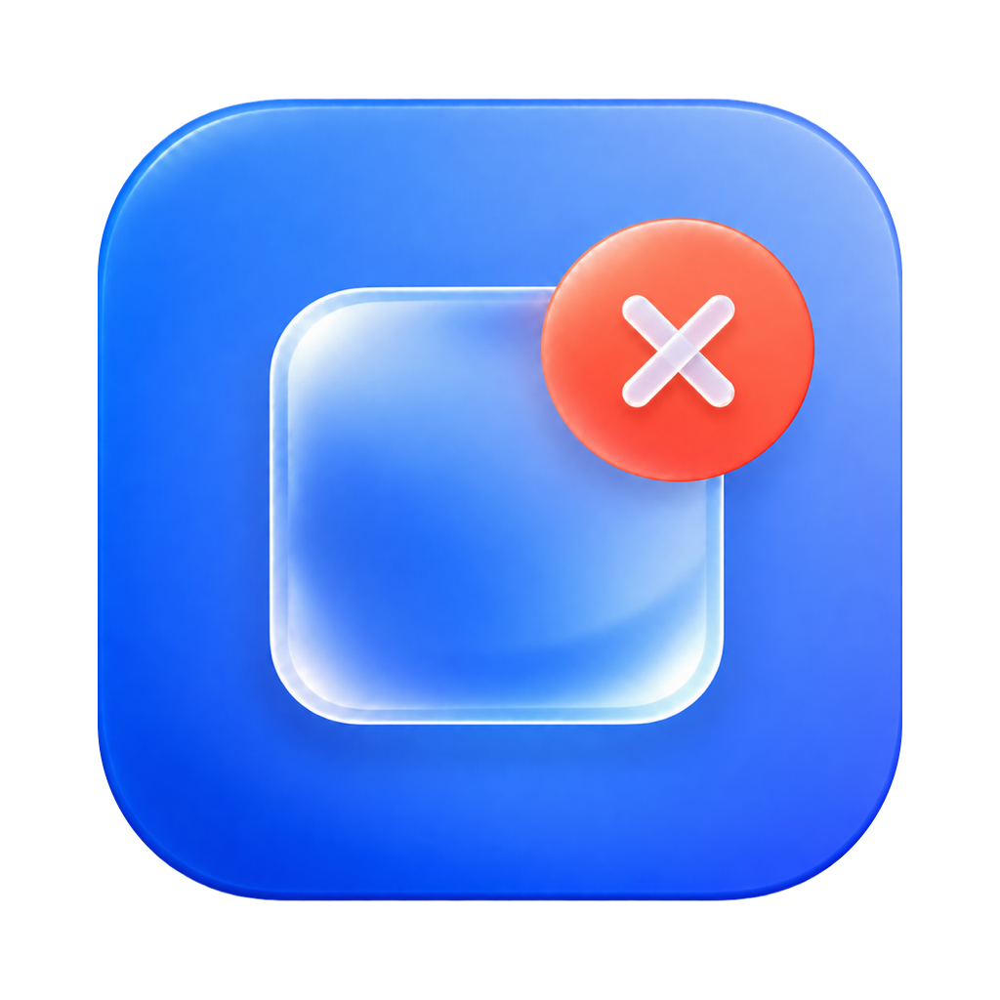

# Unbadge（実験版）



macOS 15.8.1 向けの、Dockの通知バッジを調整するローカルアプリです。通常アプリのバッジ切替、システム設定のDockバッジの継続非表示、個別の復元を備えています。

## 実現可能性と対応範囲

| 対象 | この実験版の対応 |
| --- | --- |
| 通知設定に登録されたアプリ | バッジの保存設定を個別にオン・オフ。実際の反映はアプリに依存 |
| Dockに固定されたシステム設定 | Dock側の表示設定をオン・オフ。常駐なしで非表示を維持する実験的な方式 |
| アプリが独自に描く数字・マーク | 一律の制御は保証できない |
| 別のmacOSバージョン | 書き込みを無効化。形式を読み取れない場合はエラーを表示 |

Appleの公開APIには、通常アプリが他アプリすべてのDockバッジを統一して永続的に禁止するためのAPIは確認できませんでした。通知バッジには標準設定がありますが、アプリ自身のDock描画やシステム設定の注意表示は別途考える必要があります。端末管理用の通知構成プロファイルにもバッジ項目はありますが、今回のローカルな実験版では使用していません。

この版は非公開の設定形式を使います。App Store公開や、macOS更新後も同じように動くことを前提にした製品ではありません。常駐監視や自動起動はありません。

システム設定は、通知数をゼロにする従来の方法から、Dockに保存された表示設定をオフにする方法へ変更しました。通知数がOSによって再生成されても、このスイッチは通知数に連動しません。OS更新やDockへの追加し直しで設定が戻る可能性はあります。システム設定のウィンドウ内の「アップデートあり」表示は対象外です。macOS 15.8.1の実機で、設定の開閉・Mac再起動・更新確認後もDockバッジが非表示を維持するかは未検証です。

設定操作時の書き込みとDock再起動以外に、定期ポーリングやバックグラウンド処理を追加しません。追加消費電力の実測は行っていません。

## 使い方

1. 以下の手順でインストールした `Unbadge.app` を開きます。
2. アプリを検索してスイッチを切り替えます。システム設定も同じ一覧に表示します。
3. 通常アプリは設定保存後に通知サービスを再起動します。システム設定はオフでDockバッジを継続非表示にし、オンで表示を許可します。バッジが現在なくてもオフにできます。反映時にDockを再起動します。
4. アプリごとの「元に戻す」は、このアプリで最初に変更する前のバッジ設定へ戻します。

システム設定がDockに固定されていない場合は、Dockのアイコンを右クリックし「オプション」→「Dockに追加」を選んでからUnbadgeを再読み込みしてください。対象が見つからない、重複している、形式が未対応の場合は理由を表示してスイッチを無効化します。自動でDockへ追加したり並べ替えたりはしません。

一覧には、通知設定の登録項目から実在する `.app` を確認できたものと、システム設定を表示します。通知用の `.bundle`、アプリ内の補助プログラム、バックグラウンド専用プログラム、参照先のない登録は表示しません。元のOS設定は削除しません。メニューバーアプリと、通常とは内部形式の異なる Passwords.app も対象です。インストール済みの全アプリを網羅する一覧ではありません。

通常アプリのスイッチは通知バッジの保存設定、システム設定のスイッチはDock側のバッジ表示設定を表します。システム設定の「オン」は表示の許可であり、存在しないバッジを新しく作る操作ではありません。どちらもDock上の実際の描画を保証する表示ではありません。

## 保存・復元

- 通常アプリは `com.apple.ncprefs` の対象アプリの `flags` のうち、`0x2` ビットだけを変更します。通知音、バナー、通知許可の値は変更しません。
- システム設定は `com.apple.dock` の `persistent-apps` から `bundle-identifier = com.apple.systempreferences` の項目を一意に特定し、`tile-data.dock-extra` の真偽値だけを変更します。Dockの並び順や他のアプリ・ブックマークを保持し、`AttentionPrefBundleIDs` とソフトウェアアップデートの設定は変更しません。
- 書き込み前に復元記録を `~/Library/Application Support/BadgeControl/undo.plist` に保存します。バックアップを保存できない場合、設定を変更しません。
- 復元記録の保存先は旧版との互換性のため維持しています。Dockの元の真偽値は `settingsDock` に保存します。0.4.1以前の `attention` 記録は「元に戻す」から引き続き復元できます。新しいスイッチのオンでは旧版の通知数を復元しません。
- 保存結果を読み戻し、結果が一致しなければ成功とは表示しません。Dock再起動後にも表示設定を再確認します。再起動に失敗した場合も別途エラーを表示します。
- 復元は対象アプリを再度特定して実行するため、Dockの並べ替えや追加後も他の設定を保持します。旧版の通知数を復元する際は、OSが後から再生成した非ゼロ値を上書きしません。
- 書き込む直前にも競合を確認します。ただし、OSとの間で原子的にロックできる公開APIではないため、同時更新を完全には排除できません。操作中はmacOS側の通知設定を同時に編集しないでください。

復元する場合は、アプリ内の復元ボタンを使用してからアプリを削除してください。単にアプリを終了・削除しても、変更した設定は自動で元に戻りません。復元記録は別のMacへ移さないでください。

## ビルド・検証

従来版はApple Silicon の macOS 15.8.1、Command Line Tools の Swift 6.2.4 でビルドしています。Xcodeアプリ本体や追加のパッケージは不要です。0.5.0ではGitHub ActionsのmacOS 15環境でもテストとビルドを行います。CIは実機でのバッジ描画・持続性の検証を代替しません。

```sh
./test.sh
./Tests/build.sh
./build.sh
./install.sh
open ~/Applications/Unbadge.app
```

ビルド先は既定でリポジトリ内の `.build/Unbadge.app` です。ローカル用のアドホック署名を付けます。Developer ID署名・公証はしていません。

`./install.sh` は現在のユーザーの `~/Applications/Unbadge.app` へインストールし、Launch Servicesへの登録と、そのアプリだけのSpotlight再取り込みを行います。更新前にはUnbadgeを終了してください。更新時も同じ場所へ置き換えます。ほかの場所を使う場合は `./install.sh /Applications/Unbadge.app` のように指定できますが、書き込み可能な場所が必要です。

アプリは毎回新しいバンドルとしてビルドし、成功してから旧版を置き換えます。古いアイコンや実行ファイルは引き継ぎません。アイコンファイル名には画像のハッシュを含め、絵が変わるとmacOSへ異なるリソースとして登録されます。

以前の `Badge Control.app` や展開した `Unbadge.app` が別の場所に残っていると、SpotlightやAlfredに複数表示される場合があります。旧版を残す場合は `.noindex` で終わるフォルダへ退避してください。ZIPのまま保存しているファイルはアプリとして登録されません。インストーラーはほかの場所のコピーを自動で削除しません。

テストは一時領域とメモリ内の設定を使い、ユーザーのDock・通知設定を変更しません。既存の通常アプリのフラグ操作・アプリ判定・旧版の復元に加え、通知数の再生成後のオフ維持、Dock並べ替え後の復元、対象不明・不正形式・バックアップ失敗時の中止、保存前後の競合、保存不一致、Dock再起動後の設定リセットを検証します。

実機確認の結果は `VERIFICATION.md` を参照してください。

## アイコンと公開内容

`Resources/AppIcon.png` はユーザーが選んだ製品アイコンを仕上げた1024×1024pxの素材です。青い角丸の本体、中央の透明な四角、珊瑚赤のバッジ、乳白色ガラスの×を使用しています。角丸の外側は透明にし、生成画像の外周にあったノイズを除いています。比較テストの出力ではなく、ビルドに必要な固定の製品素材としてGitで管理します。CIの一時成果物だけでは、クローンした環境で同じアイコンを再生成できないためです。

ビルド時にmacOS付属の `sips` で16〜1024pxの画像を作り、`Scripts/pack-icon.swift` でPNGのままICNSのサイズ別要素へ格納します。`iconutil`による透明画像の格納・再展開では16px・32pxの色が変わったため、PNGの色とアルファを保持する方式です。PNG要素の一致に加え、macOSのImageIOによるデコード結果も確認しています。原画は再描画せず縮小だけを行います。生成されたアイコンセット、アプリ本体、画面キャプチャ、画像差分、実機の通知設定や復元記録はGitへ含めません。

この版はmacOS 15.8.1向けの静的なガラス調アイコンです。1024px・sRGB・RGBAの素材、透明な外余白、各サイズの表示を確認しています。Icon Composerの多層形式による動的なLiquid Glassや、外観別の自動切替には対応していません。Appleの現行ガイドラインに完全準拠した多層アイコンとしての認証・検証を意味しません。[Appleの制作方法](https://developer.apple.com/documentation/Xcode/creating-your-app-icon-using-icon-composer)を参照してください。

アプリにネットワーク送信・解析サービス・管理者権限要求はありません。操作によって現在のユーザーの通知設定またはDockの設定を書き換え、`usernoted` またはDockを再起動します。非公開設定に依存する実験版として、上記の対応範囲と復元方法を確認してください。

## 調査に使用した資料

- [Apple：Macの通知設定](https://support.apple.com/guide/mac-help/notifications-settings-mh40583/mac)
- [Apple：通知の許可を求めるAPI](https://developer.apple.com/documentation/UserNotifications/asking-permission-to-use-notifications)
- [Apple：NSDockTile.badgeLabel](https://developer.apple.com/documentation/appkit/nsdocktile/badgelabel)
- [Apple：端末管理の通知設定スキーマ](https://github.com/apple/device-management/blob/release/mdm/profiles/com.apple.notificationsettings.yaml)
- [ncprefs.py：非公開通知設定を扱う既存実装と制約](https://github.com/drewdiver/ncprefs.py)
- [FocusNoBadges：バッジビットと通知サービス再起動に関する実装報告](https://github.com/FuzzDOT/FocusNoBadges)
- [Jeff Johnson：Dockのdock-extraを使ったシステム設定バッジの非表示](https://lapcatsoftware.com/articles/badge.html)
- [Sequoia向けのDockバッジ非表示手順とOS更新後の制約](https://github.com/travisvn/stop-tahoe-update/blob/main/docs/REMOVE_DOCK_BADGE.md)

既存ツールの報告は方式の参考資料です。今回のMacで全アプリの実表示が検証済みであることを意味しません。
